# Dev7e — Private Amazon ECR Registry & Docker Compose Deployment on AWS Lightsail

**Deploying Python Girls That Code to a remote Ubuntu host using a private ECR image, SSH/SCP, Docker Compose, MongoDB and Mongo Express.**

   

> **Scope:** This is a learning deployment, not a production-hardened system. The published application UI was verified; Mongo Express browser access and a remote persistence test were not performed.

**Navigation:** [Architecture](#03--end-to-end-architecture) · [ECR](#04--ecr-creating-a-private-repository) · [IAM](#05--windows-aws-cli-and-iam-authentication) · [Lightsail](#07--lightsail-instance-provisioning-and-ssh) · [Docker Compose](#10--remote-compose-configuration-and-environment-files) · [Validation](#12--lightsail-firewall-browser-access-and-verification) · [Screenshot map](assets/screenshots/SCREENSHOT-MAP.md)

---

## 01 — Executive Summary

**Dev7e** demonstrates deployment of the existing **Python Girls That Code** FastAPI application to an AWS Lightsail Ubuntu instance using **Amazon ECR as a private Docker registry** and **Docker Compose** to orchestrate the application, MongoDB and Mongo Express. The application image was reused rather than rebuilt. The deployment moves from a self-hosted Nexus image registry in Dev7b to AWS-managed ECR, while preserving the containerisation and networking lessons of Dev7a/Dev7c.

**Observed outcome:** the ECR image was successfully pushed and pulled; the three-service stack started; MongoDB was reported healthy; and the FastAPI UI was loaded from a Windows browser using the Lightsail public address on port 8001. Mongo Express started but its browser UI was **not tested**. A teardown/restart persistence test was **not documented** for this remote deployment.

| Aspect | Implementation |
|---|---|
| Cloud | AWS Lightsail (Ubuntu 24.04.5 LTS, x86_64), eu-west-1 |
| Registry | Amazon ECR private repository `python-girls-that-code` |
| Application | Existing FastAPI image, tag `1.0`, linux/amd64 |
| Orchestration | Docker Engine + Docker Compose plugin |
| Supporting services | MongoDB and `techworldwithnana/mongo-express` |
| Data | Docker named volume mounted at `/data/db` |
| Ingress | FastAPI host TCP 8001, firewall restricted to developer public IP /32 |
| Deployment | SSH, SCP, AWS CLI, Docker login, Docker Compose |


---

## 02 — Project Motivation, Scope and Lineage

The previous projects established a reusable application and the mechanics of a private registry. Dev7e asks a different question: **can an image published from a Windows development environment be securely retrieved by a separate Linux cloud host and run as part of a multi-service application?**

- [Dev7a — Docker for Python Girls That Code](https://github.com/ChiomaScripts/Dev7a-docker-python): original application and containerisation.
- [Dev7b — Private Docker Registry with Nexus](https://github.com/ChiomaScripts/Dev7b-docker-nexus-registry): private image distribution using self-hosted Nexus.
- [Dev7c — Docker Compose and Persistent MongoDB](https://github.com/ChiomaScripts/Dev7c-docker-compose-volumes): local multi-container orchestration and volume persistence.
- **Dev7e (this repository):** AWS ECR publication, remote Lightsail deployment, remote image retrieval, SSH/SCP, cloud firewall access.

Dev7e does **not** claim CI/CD, infrastructure as code, TLS termination, managed database hosting, autoscaling, or production hardening.


---

## 03 — End-to-End Architecture

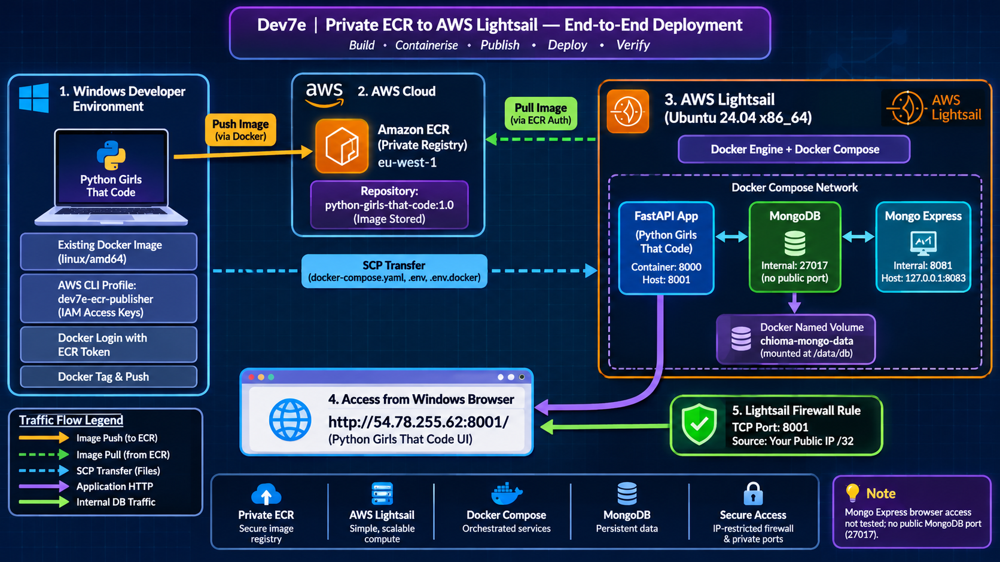


**Control plane versus data plane.** The AWS CLI authenticates API calls using IAM credentials. Docker authenticates independently to the ECR registry using a temporary token obtained by `aws ecr get-login-password`. SSH authenticates access to the Lightsail Linux host using an SSH private key. These are three distinct security boundaries.

**Image path:** Windows local Docker image → ECR registry → authenticated Docker pull on Lightsail. **Configuration path:** Windows Compose/env files → SCP over SSH → Lightsail project directory. **Runtime path:** browser → Lightsail firewall → host port 8001 → FastAPI container port 8000 → Compose network DNS `mongodb:27017` → MongoDB → Docker named volume. Mongo Express is another container on the same internal network, but its web interface was bound to host loopback and not publicly tested.

The architecture images are explanatory illustrations; the commands, configuration and screenshots below are the authoritative record of observed work.


---

## 04 — ECR: Creating a Private Repository

Amazon Elastic Container Registry (ECR) is AWS's managed OCI/Docker-compatible container image registry. Like Docker Hub and a Nexus Docker-hosted repository, it stores image manifests and layers that Docker clients can push and pull. Unlike the self-hosted Nexus instance in Dev7b, AWS operates the ECR service, so there is no Nexus application, droplet, registry connector port or Nexus disk volume to maintain.

A **repository** is a named collection of related image versions. For example, `python-girls-that-code` is the repository and `1.0` is an image tag. The full URI follows `ACCOUNT_ID.dkr.ecr.eu-west-1.amazonaws.com/python-girls-that-code:1.0`. The account ID identifies the AWS registry; `eu-west-1` identifies the region. The URI is a DNS hostname, **not a registry IP address**. Tags are human-friendly references; image digests are content-addressed identifiers. ECR can display an image index, platform-specific image and auxiliary metadata as separate entries.

For this exercise a private repository was created in **Ireland (`eu-west-1`)**, using ECR's console. Encryption-at-rest and tag-mutability choices are repository configuration considerations; the source notes do not establish a particular production policy.

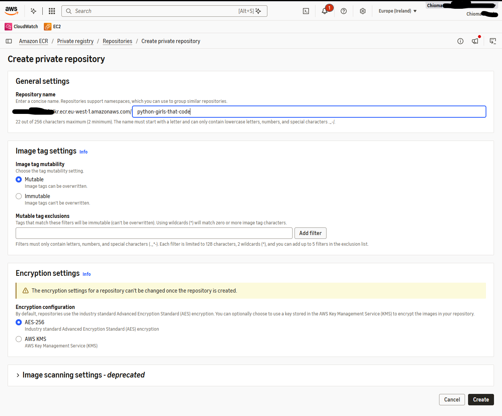


---

## 05 — Windows AWS CLI and IAM Authentication

The Windows laptop needed a way to make authenticated AWS API calls. AWS CLI is analogous to other command-line clients (Docker and Git) in that it sends requests to a remote service, but its authentication and authorization are controlled by **AWS IAM**.

AWS CLI v2 was installed on Windows. An IAM user named `dev7e-ecr-publisher` and an access key were created for the lab; the CLI was configured using the named profile `dev7e-ecr-publisher` and region `eu-west-1`. **IAM user access keys are long-lived secrets, not the same as the temporary ECR Docker token.** They should not be committed to source control, copied into README examples, or displayed in screenshots.

```powershell
aws configure --profile dev7e-ecr-publisher
aws sts get-caller-identity --profile dev7e-ecr-publisher
```

`aws configure` writes CLI settings to the local AWS configuration/credentials files. `sts get-caller-identity` checks *which identity the AWS API sees*, reducing the risk of accidentally operating as the wrong AWS user. The IAM user was reused on Lightsail for convenience; a read-only pull identity or temporary role-based credentials would be preferable for a durable deployment. The attempt to explore IAM Identity Center was discontinued; it was **not** part of the final implementation.

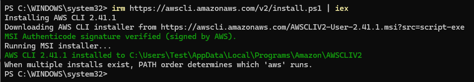

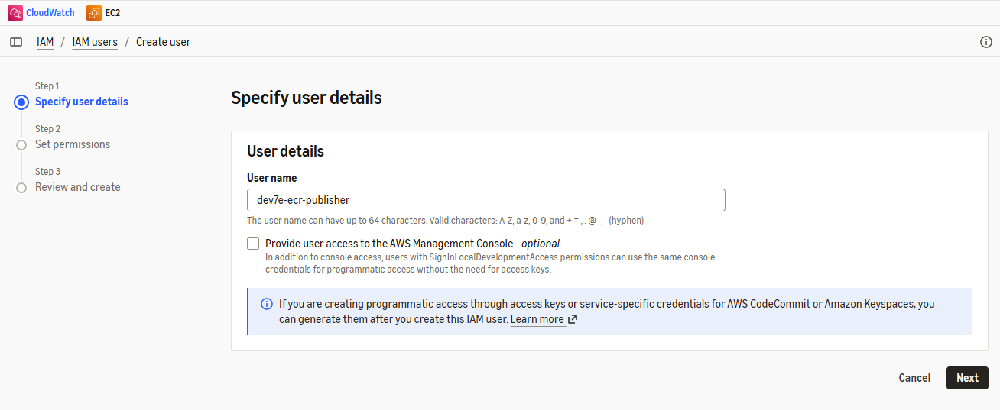

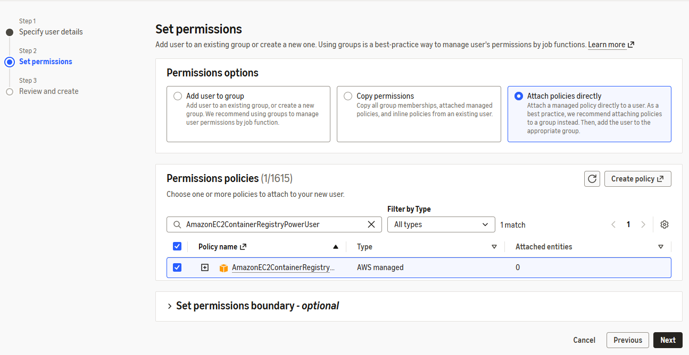

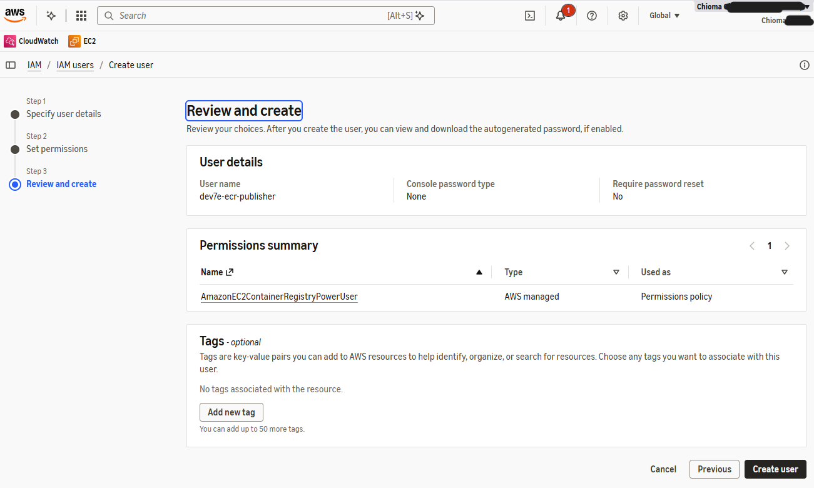

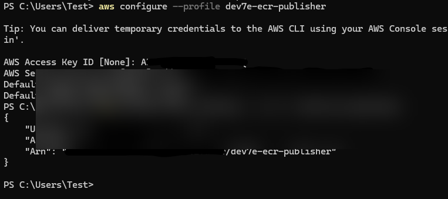


---

## 06 — Registry Discovery, Docker Login, Tagging and Push

The AWS CLI can retrieve the repository URI directly:

```powershell
aws ecr describe-repositories `
  --repository-names python-girls-that-code `
  --region eu-west-1 `
  --profile dev7e-ecr-publisher `
  --query "repositories[0].repositoryUri" `
  --output text
```

**Why log in twice?** AWS CLI credentials authenticate requests to AWS APIs; Docker has its **own registry credential store**. `get-login-password` obtains a short-lived ECR registry password, then `docker login --password-stdin` passes it to Docker without exposing it as a command-line argument. ECR authorization tokens typically last **12 hours**. Do not print or store the token in the repository.

```powershell
$REGISTRY = "ACCOUNT_ID.dkr.ecr.eu-west-1.amazonaws.com"
aws ecr get-login-password --region eu-west-1 --profile dev7e-ecr-publisher |
  docker login --username AWS --password-stdin $REGISTRY

docker image inspect python-girls-that-code:1.0 --format '{{.Os}}/{{.Architecture}}'
docker tag python-girls-that-code:1.0 "$REGISTRY/python-girls-that-code:1.0"
docker push "$REGISTRY/python-girls-that-code:1.0"
```

The local image architecture was verified as **`linux/amd64`**. `docker tag` adds another name pointing to the existing image; it does not rebuild the application. `docker push` uploads image layers and manifests to ECR. The ECR console subsequently showed the `1.0` image reference. The image's source code remains in Dev7a rather than being duplicated here.

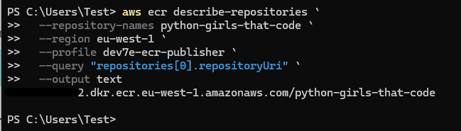

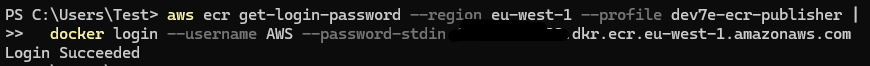

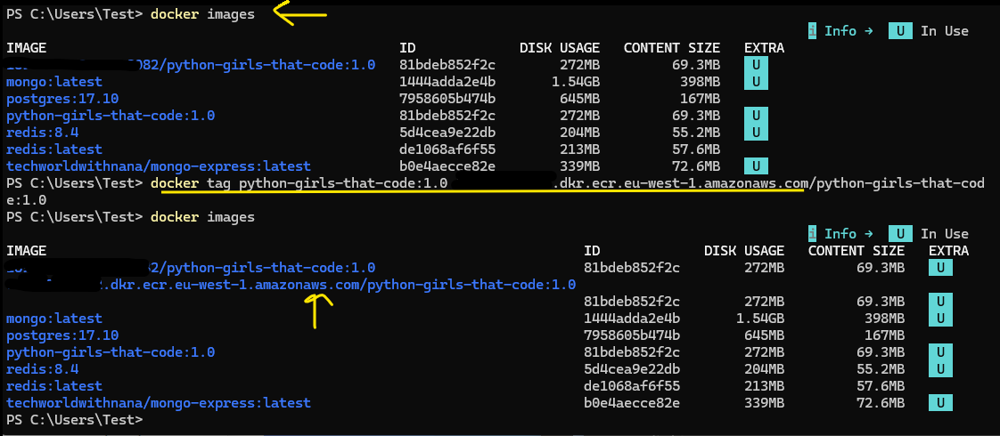

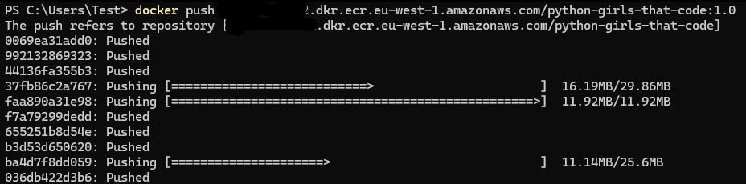

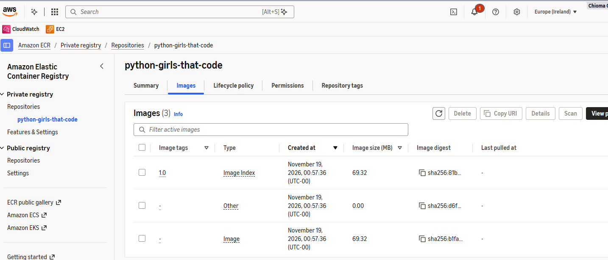


---

## 07 — Lightsail Instance Provisioning and SSH

A separate AWS Lightsail instance was provisioned in **Ireland** with **Ubuntu 24.04 LTS**, general-purpose compute and a **4 GB RAM plan**. The server reported Ubuntu 24.04.5 LTS, `x86_64`, and approximately 3.7 GiB total memory. `x86_64` is compatible with the image's `linux/amd64` architecture. `free -h` reported no swap; the absence of swap was noted, not changed.

A custom Lightsail SSH key was created and its private `.pem` file stored under the Windows user's `.ssh` directory, outside the Git repository. SSH uses the key to establish encrypted shell access; SCP uses the same SSH transport for file copies. Neither is the same as AWS API access keys.

```bash
whoami
cat /etc/os-release
uname -m
free -h
df -h /
```

These commands establish user identity, OS release, CPU architecture, memory and disk baseline before deploying services. A Lightsail instance has a **private hostname/IP** for internal AWS networking and a **public IPv4** for external SSH/browser access. The private prompt hostname `ip-172-26-14-19` was not a valid destination from Windows Git Bash.

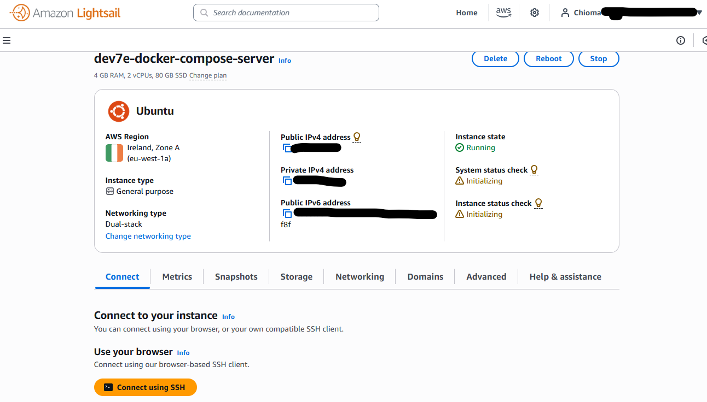

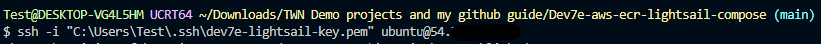


---

## 08 — Installing Docker Engine from the Official Ubuntu Repository

Docker was installed directly on Ubuntu using Docker's official apt repository, rather than installing a Docker Desktop application. The steps below are included in full because each has a distinct security or package-management purpose.

```bash
sudo apt update
sudo apt install -y ca-certificates curl
sudo install -m 0755 -d /etc/apt/keyrings
sudo curl -fsSL https://download.docker.com/linux/ubuntu/gpg \
  -o /etc/apt/keyrings/docker.asc
sudo chmod a+r /etc/apt/keyrings/docker.asc
sudo tee /etc/apt/sources.list.d/docker.sources > /dev/null <<EOF
Types: deb
URIs: https://download.docker.com/linux/ubuntu
Suites: $(. /etc/os-release && echo "${UBUNTU_CODENAME}")
Components: stable
Signed-By: /etc/apt/keyrings/docker.asc
EOF
sudo apt update
sudo apt install -y docker-ce docker-ce-cli containerd.io docker-buildx-plugin docker-compose-plugin
```

- `apt update` refreshes package indexes; it **does not upgrade** installed packages.
- `ca-certificates` enables TLS certificate verification for HTTPS downloads; `curl` retrieves remote content.
- `install -m 0755 -d` creates the keyring directory with explicit permissions (`rwxr-xr-x`).
- Docker's `gpg` key is saved as `/etc/apt/keyrings/docker.asc`, and `chmod a+r` makes it readable by the package manager.
- The `.sources` file registers Docker's repository; `Signed-By` restricts package signature verification to the specified key. The `$(...)` expression reads the OS codename (`noble`) dynamically. `tee` writes the privileged file, while `> /dev/null` suppresses its echo.
- The second `apt update` makes apt discover the newly registered repository. `docker-ce` is the daemon/engine, `docker-ce-cli` is the client, `containerd.io` supports container execution, `buildx` adds extended build capabilities and `docker-compose-plugin` enables the modern `docker compose` command.

```bash
sudo systemctl status docker --no-pager
sudo docker run --rm hello-world
sudo usermod -aG docker ubuntu
newgrp docker
docker ps
```

`hello-world` confirms Docker can pull and execute a container. `usermod -aG` **appends** `ubuntu` to the `docker` group without replacing existing supplementary groups. `newgrp docker` applies that membership in a new shell. Successful `docker ps` without `sudo` verifies access to the daemon socket. **Membership of the Docker group is effectively root-equivalent**, so this is a privilege decision, not merely a convenience.

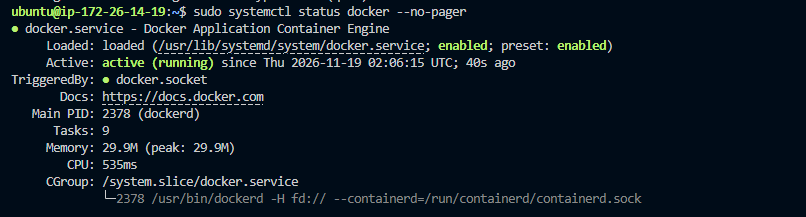

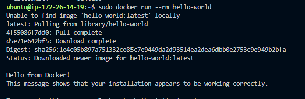

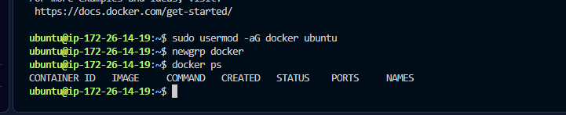


---

## 09 — Authenticating Lightsail and Pulling the Private Image

A second machine does not inherit Docker or AWS CLI credentials from the Windows laptop. AWS CLI v2 was therefore installed on the Ubuntu x86_64 server; the existing `dev7e-ecr-publisher` IAM identity was configured again for the short-lived lab. The CLI then obtained an ECR login token, which was passed to Docker. This demonstrates the **publisher** and **consumer** ends of private image distribution using the same registry.

```bash
sudo apt install -y curl unzip
curl -fsSL https://awscli.amazonaws.com/awscli-exe-linux-x86_64.zip -o awscliv2.zip
unzip -q awscliv2.zip
sudo ./aws/install
aws --version
aws configure --profile dev7e-ecr-publisher
aws sts get-caller-identity --profile dev7e-ecr-publisher
REGISTRY="$(aws sts get-caller-identity --profile dev7e-ecr-publisher --query Account --output text).dkr.ecr.eu-west-1.amazonaws.com"
aws ecr get-login-password --region eu-west-1 --profile dev7e-ecr-publisher | docker login --username AWS --password-stdin "$REGISTRY"
docker pull "$REGISTRY/python-girls-that-code:1.0"
docker images
```

The Docker pull completed and the ECR-tagged image appeared in the server's local image list. This is independent verification that the remote host could authenticate to ECR and retrieve the private image. The repository stores no IAM secrets. On long-lived systems, prefer temporary scoped credentials and ensure Docker can reauthenticate when pulling after a token expires.

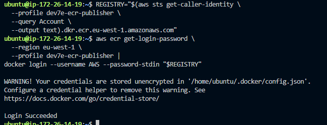

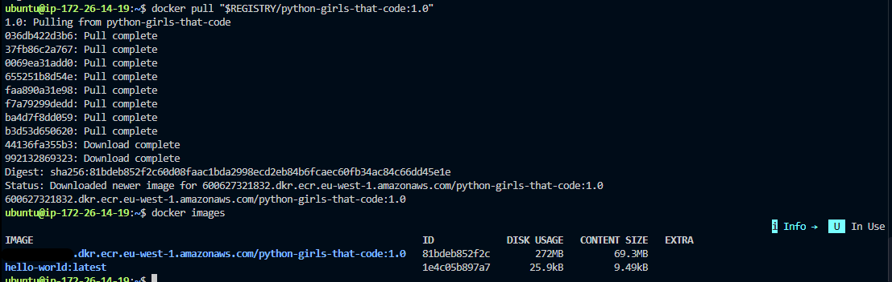


---

## 10 — Remote Compose Configuration and Environment Files

Dev7e uses a **separate project directory** so Dev7c's tested local Compose configuration remains unchanged. The new Compose file points at ECR, and its port bindings suit a cloud-hosted deployment. The environment files are excluded from Git; the checked-in `.env.example` and `.env.docker.example` contain placeholders only.

```yaml
services:
  chioma-python-app:
    image: ${ECR_IMAGE_URI}
    ports:
      - "8001:8000"
    env_file:
      - .env.docker
    depends_on:
      mongodb:
        condition: service_healthy
    restart: unless-stopped

  mongodb:
    image: mongo
    env_file:
      - .env.docker
    volumes:
      - chioma-mongo-data:/data/db
    healthcheck:
      test: ["CMD-SHELL", "mongosh --quiet --eval "db.adminCommand('ping').ok" | grep -q 1"]
      interval: 10s
      timeout: 5s
      retries: 10
      start_period: 30s
    restart: unless-stopped

  mongo-express:
    image: techworldwithnana/mongo-express
    ports:
      - "127.0.0.1:8083:8081"
    env_file:
      - .env.docker
    depends_on:
      mongodb:
        condition: service_healthy
    restart: unless-stopped

volumes:
  chioma-mongo-data:
    driver: local
```

**Important:** The YAML above is a **sanitised reconstruction** from the recorded Dev7e deployment details and Dev7c lineage; the uploaded notes do not contain a verbatim Dev7e YAML export. Validate it against your local actual Compose file before replacing any already-tested configuration. The example assumes the `.env` file defines `ECR_IMAGE_URI` (see `.env.example`). The observed running services and published ports are documented by the deployment screenshots.

Compose's project network gives containers service-name DNS resolution: FastAPI reaches `mongodb:27017`, not `localhost:27017`. The named volume survives `docker compose down` by default; `down -v` removes it. `depends_on: condition: service_healthy` delays initial startup until MongoDB passes its health check, but is not an ongoing health-management system. `env_file` injects variables **into containers**, whereas `.env` provides **Compose variable interpolation**. Avoid distributing every secret to every service in a production setup. MongoDB's internal port **27017 is not published publicly**. Mongo Express was bound to host loopback only.


---

## 11 — Secure File Transfer, Validation and Launch

On Lightsail, a deployment directory was created. On Windows, **Git Bash** was used to SCP the Compose YAML and two environment files. An initial attempt failed because the multiline command used **PowerShell backticks** instead of Bash backslashes. A subsequent attempt failed because `ip-172-26-14-19` was an internal hostname, not a publicly resolvable Lightsail destination. Switching to the server's public IPv4 and Git Bash syntax resolved the issue.

```bash
# On Lightsail
mkdir -p ~/dev7e-aws-ecr-lightsail-compose
```

```bash
# On Windows Git Bash (replace the placeholder with your Lightsail public IPv4)
scp -i ~/.ssh/dev7e-lightsail-key.pem \
  docker-compose.yaml .env .env.docker \
  ubuntu@YOUR_LIGHTSAIL_PUBLIC_IP:~/dev7e-aws-ecr-lightsail-compose/
```

```bash
# Back on Lightsail
cd ~/dev7e-aws-ecr-lightsail-compose
ls -la
chmod 600 .env .env.docker
docker compose config --quiet
docker compose config --images
docker compose up -d
docker compose ps
```

`chmod 600` grants the owner read/write access and removes permissions for group/others. `config --quiet` checks Compose syntax/interpolation without printing expanded secrets; `config --images` lists the three resolved images. `up -d` creates/starts the network, volume and services in detached mode. The observed output showed **MongoDB healthy**, **FastAPI up** and **Mongo Express up**. `docker compose ps` showed host port 8001 mapped to app port 8000, Mongo Express bound to 127.0.0.1:8083, and MongoDB without a published host port.

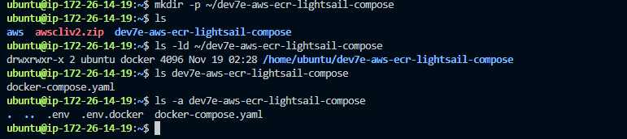

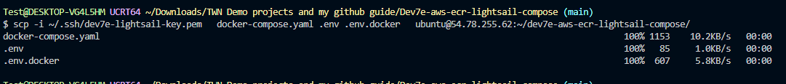

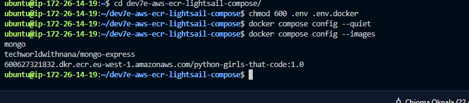

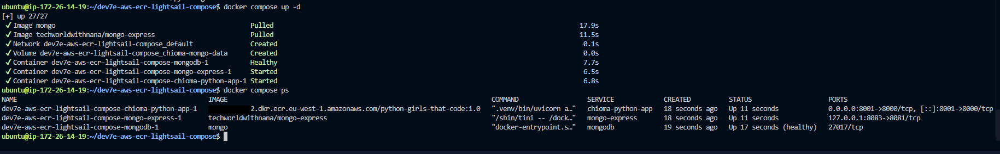


---

## 12 — Lightsail Firewall, Browser Access and Verification

Docker port publishing is only one layer of network access. Lightsail also has an **instance firewall** that governs inbound traffic. A custom inbound **TCP 8001** rule was added, restricted to the Windows network's **public IPv4 `/32`**, not the Lightsail server's own IP. `/32` denotes one specific IPv4 address. The browser then successfully loaded the **Python Girls That Code** UI at `http://LIGHTSAIL_PUBLIC_IP:8001/`.

**What this proves:** the Lightsail host is reachable through the firewall; Docker forwards traffic from host 8001 to container 8000; and the FastAPI server responds with the UI. **What it does not independently prove:** successful database writes, Mongo Express web access, or survival of data across a remote Compose teardown. The MongoDB health check and running Mongo Express container are useful supporting evidence but are not substitutes for functional testing.

Mongo Express was deliberately left bound to `127.0.0.1:8083`; it could be reached via an SSH local port-forward if required, without exposing its admin interface publicly. No MongoDB 27017 inbound rule should be added. The demonstrated UI used HTTP, not HTTPS, and is suitable only for a limited learning exercise with non-sensitive test data.

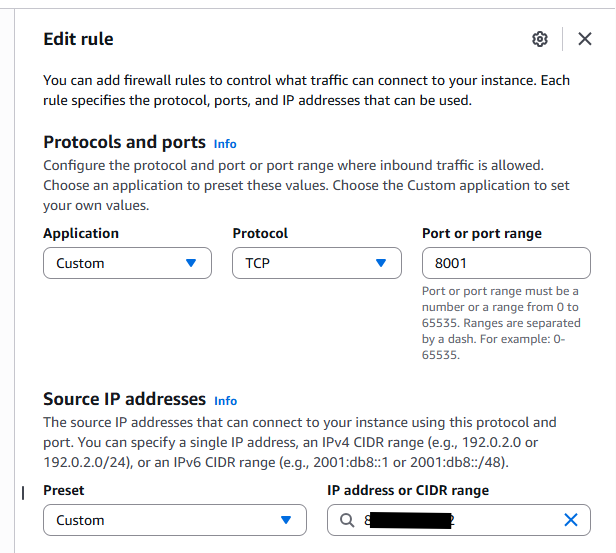

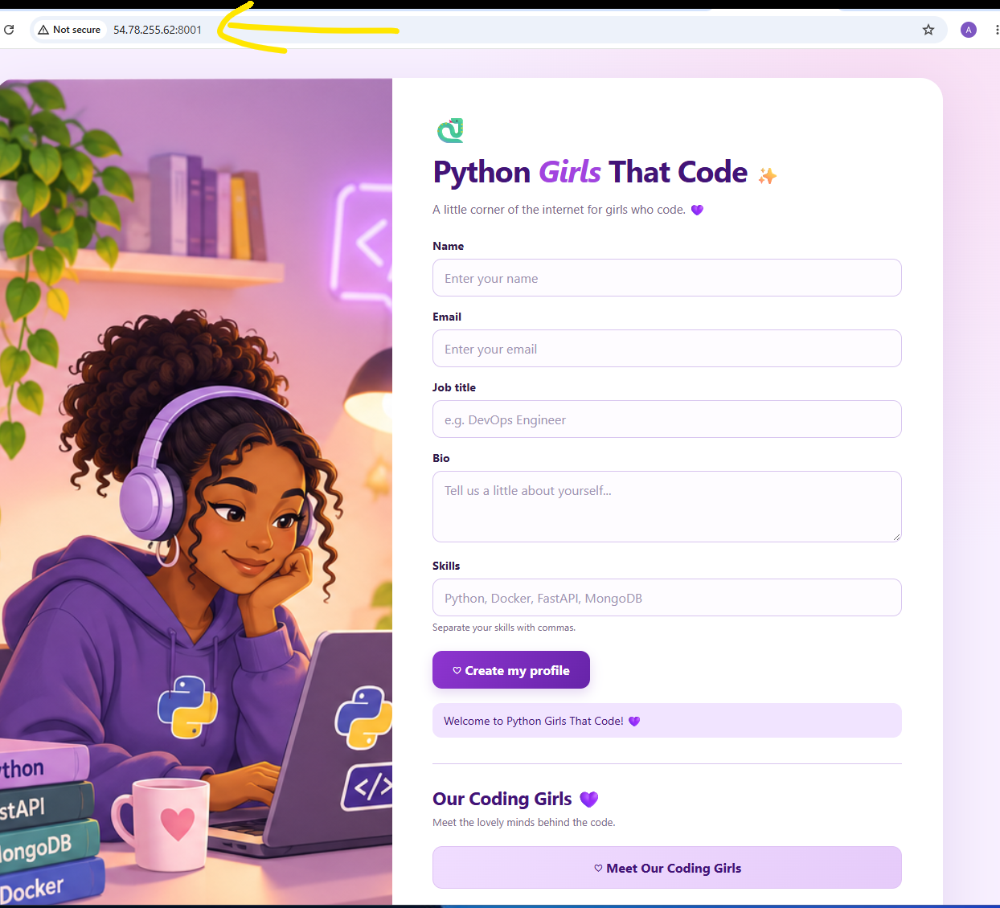


---

## 13 — Troubleshooting and Engineering Decisions

| Observation | Investigation / cause | Resolution / learning |
|---|---|---|
| AWS CLI on Ubuntu initially unavailable | Fresh Lightsail Ubuntu installation | Installed AWS CLI v2 separately from Docker |
| Windows SCP command split into errors | PowerShell backtick used in Git Bash | Replaced with Bash `\` line continuations |
| `Could not resolve hostname ip-172-26-14-19` | Internal Lightsail hostname used from Windows | Used public IPv4 address |
| Private ECR image requires separate login on server | AWS CLI and Docker credentials are machine-local and distinct | Configured AWS CLI and authenticated Docker on Lightsail |
| Mongo Express not accessible at public port | Deliberate `127.0.0.1` binding | Left private; did not expose admin UI |
| IAM Identity Center setup felt disproportionate for lab | More extensive identity administration than needed for short exercise | Used a dedicated IAM user; recognised stronger production alternatives |

The project highlights a deliberate trade-off: reusing the IAM publisher credentials for ECR pulls accelerated the lab, but the server should ideally have **pull-only, temporary credentials**. Security shortcuts are documented explicitly rather than presented as recommended production practice.


---

## 14 — Operational Security, Cost and Teardown

**Credentials:** Keep `.env`, `.env.docker`, `.pem` keys and AWS CLI credentials out of Git. Use unique credentials for any internet-connected environment. For production, prefer IAM least privilege, short-lived credentials, managed secrets, and HTTPS. If a long-lived AWS access key was copied to Lightsail, remove the server-side copy and rotate/revoke the key when it is no longer needed; do not revoke a key still used by other workflows without planning a replacement.

**Exposure:** Restrict port 8001 to the developer's IP for the lab. Keep MongoDB internal and Mongo Express loopback-only. Close the firewall rule after testing. Consider a reverse proxy, HTTPS and application authentication before any real deployment.

**Billing:** Lightsail instance bundles are advertised at monthly prices but may accrue prorated hourly usage while provisioned, subject to the plan's billing rules and cap; deleting the instance stops its ongoing instance charge, but **snapshots, static IPs, ECR image storage and other AWS resources can incur separate charges**. Check the AWS Billing console rather than assuming all resources are covered by one Lightsail price.

**Clean up after evidence capture:** `docker compose down` stops/removes the stack without deleting the named volume by default; `docker compose down -v` also deletes named volumes and data. Delete the disposable Lightsail instance only after saving evidence and any needed data. Remove ECR images/repositories only if no longer needed, review access keys, and check for remaining billable resources.


---

## 15 — Lessons Learned and Next Steps

The strongest learning is **interoperability**. Docker-compatible registry semantics transfer between Nexus and ECR even though the operational responsibilities differ. With Nexus, the engineer provisioned and maintained a registry service. With ECR, AWS manages the registry, leaving the engineer to focus on repository configuration, IAM authorization and image lifecycle. Lightsail similarly simplifies server provisioning but **does not remove responsibility for Linux administration, Docker, networking, secrets or operational security**.

Potential follow-up exercises (not completed here) include testing CRUD persistence after container recreation; accessing Mongo Express over an SSH tunnel; configuring image scanning and lifecycle policies; separating publisher and puller permissions; using temporary credentials; HTTPS and domain configuration; monitoring; and CI/CD automation.

This README is both an implementation case study and a technical revision reference. It intentionally distinguishes **observed evidence**, **conceptual explanation** and **future improvements**.


---

## 16 — Evidence and Screenshot Index

The screenshots below are extracted from the original learning notes, renamed sequentially in **README reading order**, and stored under `assets/screenshots/`. Sensitive IAM/credential portions have been obscured where appropriate. The original Word file is not included in the public repository.

See [`assets/screenshots/SCREENSHOT-MAP.md`](assets/screenshots/SCREENSHOT-MAP.md) for the original document page, approximate position, filename and README section.


